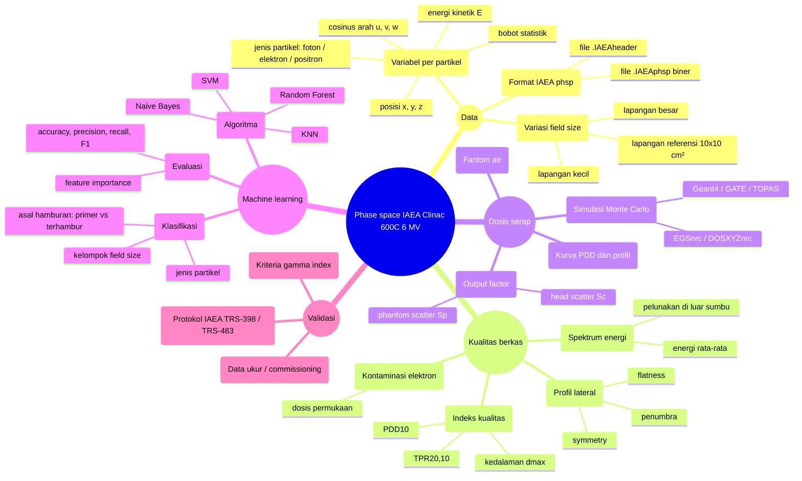
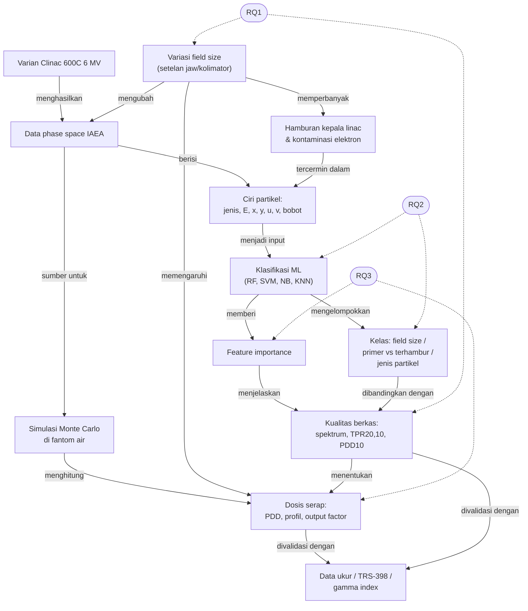

# Mind Map & Concept Map — Ide Riset

**Topik:** Klasifikasi data *phase space* IAEA untuk menilai pengaruh variasi *field size* terhadap kualitas berkas X-ray dan dosis serap pada Varian Clinac 600C 6 MV
**Sumber data:** IAEA Phase-space Database for External Beam Radiotherapy, https://www-nds.iaea.org/phsp/photon1/

Mengikuti langkah di slide `07_mind_map_concept_map.pdf` (hlm. 20–21, 40):
1. **Mind map** untuk mengeksplorasi ide riset secara luas (*brainstorming*)
2. **Concept map** untuk menghubungkan konsep dan menajamkan **pertanyaan riset**
3. Membandingkan hasil kedua alat visual

Diagram ditulis dalam **Mermaid**, sama seperti di slide (hlm. 23–37). Diagram akan otomatis tergambar bila file ini dibuka di GitHub (issue/README) atau di VS Code dengan ekstensi Mermaid.

> ⚠️ **Perlu dicek sendiri:** halaman IAEA tidak bisa saya akses (diblokir pemeriksaan bot). Ukuran lapangan dan format file yang tersedia untuk Clinac 600C 6 MV di bawah ini masih **asumsi umum**. Sesuaikan dengan yang benar-benar tersedia di database.

---

## 1. Mind map (eksplorasi ide)

**Ide-ide riset yang muncul dari mind map:**
1. Bagaimana spektrum energi dan sudut partikel berubah seiring bertambahnya ukuran lapangan?
2. Dapatkah ML mengenali ukuran lapangan hanya dari ciri partikel di bidang *phase space*?
3. Dapatkah ML memisahkan foton primer dari foton terhambur (*head scatter*) yang memengaruhi output factor?
4. Seberapa besar perubahan PDD, TPR20,10, dan penumbra akibat field size, dan apakah ML dapat memprediksinya?
5. Seberapa besar kontaminasi elektron sebagai fungsi field size, dan apa dampaknya pada dosis permukaan?

---

## 2. Concept map (menajamkan pertanyaan riset)

Berbeda dengan mind map, concept map memakai **panah berlabel** untuk menyatakan hubungan, dan satu konsep boleh punya lebih dari satu induk.

### Pertanyaan riset yang dihasilkan
- **RQ1:** Bagaimana pengaruh variasi field size terhadap kualitas berkas X-ray 6 MV Varian Clinac 600C (spektrum energi, energi rata-rata, TPR20,10, PDD10) berdasarkan data phase space IAEA?
- **RQ2:** Seberapa akurat algoritma klasifikasi (Random Forest, SVM, Naive Bayes, KNN) dalam membedakan data phase space dari field size yang berbeda, dengan masukan ciri tiap partikel (energi, posisi, arah, jenis partikel)?
- **RQ3:** Ciri partikel mana yang paling menentukan perbedaan antar field size (menurut *feature importance*), dan bagaimana kaitannya dengan perubahan dosis serap (PDD, profil, output factor) di fantom air?

### Rumusan judul (usulan)
*Klasifikasi Data Phase Space IAEA Berbasis Machine Learning untuk Menilai Pengaruh Variasi Field Size terhadap Kualitas Berkas X-Ray dan Dosis Serap pada Varian Clinac 600C 6 MV*

---

## 3. Apakah hasil kedua alat visual sama atau berbeda?

**Berbeda, dan keduanya saling melengkapi.**

| Aspek | Mind map | Concept map |
|---|---|---|
| Tujuan | mengumpulkan sebanyak mungkin ide | memilih yang relevan dan menghubungkannya |
| Struktur | satu pusat, bercabang (pohon), tiap node punya satu induk | jaringan; satu konsep bisa punya beberapa induk (mis. *phase space* dipengaruhi linac **dan** field size) |
| Hubungan | garis tanpa label | panah berlabel (*mengubah*, *menjadi input*, *divalidasi dengan*) |
| Hasil | daftar 5 ide riset yang luas (termasuk validasi, protokol, beberapa kode MC) | 3 pertanyaan riset yang terfokus dan saling terkait |
| Yang hilang/tersaring | — | ide sampingan seperti flatness/symmetry dan protokol TRS-483 tidak menjadi RQ utama |

Mind map menunjukkan **apa saja** yang bisa diteliti. Concept map menunjukkan **bagaimana** konsep-konsep itu saling memengaruhi: field size → hamburan → ciri partikel → klasifikasi → kualitas berkas → dosis. Rantai sebab-akibat itulah yang menjadi dasar pertanyaan riset.
