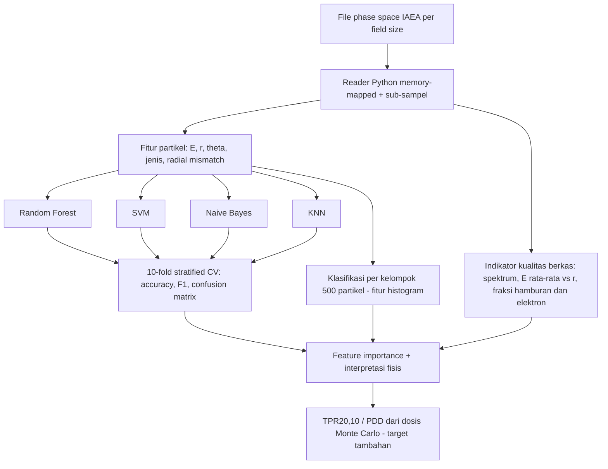

Nama: [NAMA LENGKAP]
NIM: [NIM]
Project: **Klasifikasi Data Phase Space IAEA: Pengaruh Field Size terhadap Kualitas Berkas X-Ray Varian Clinac 600C 6 MV**

## Team Members
1. [Nama 1] ([NIM])
2. [Nama 2] ([NIM])
3. [Nama 3] ([NIM])
4. [Nama 4] ([NIM])

## Project Overview
- **Data source:** IAEA Phase-space Database for External Beam Radiotherapy (www-nds.iaea.org/phsp/photon1), Varian Clinac 600C 6 MV, beberapa field size. Format IAEA: `.IAEAheader` + `.IAEAphsp` (per partikel: jenis, E, x, y, u, v, w, bobot).
- **Method:**

- **ML category:** Supervised learning, klasifikasi multikelas (label = field size)
- **Estimated timeline:**

| Kegiatan | M1 | M2 | M3 | M4 |
|---|---|---|---|---|
| Reader IAEA + pipeline + uji data sintetis | ✅ | | | |
| Unduh dan jalankan data asli IAEA | | 🟧 | | |
| Analisis kualitas berkas + feature importance | | 🟧 | 🟧 | |
| Dosis Monte Carlo (TPR20,10, PDD) - opsional | | | 🟧 | 🟧 |
| Medium, YouTube, Gist, OSF | | | | 🟧 |

## Content
- **Problem definition:** Saat field size diperbesar, hamburan kepala linac dan kontaminasi elektron bertambah sehingga spektrum dan dosis berubah. Efek ini tersembunyi di jutaan partikel phase space, dan belum jelas ciri partikel mana yang paling membedakan field size.
- **Proposed solution:** Pipeline Python yang membaca format IAEA langsung, klasifikasi field size dari ciri partikel (RF, SVM, NB, KNN) dengan feature importance, serta indikator kualitas berkas per field size.
- **Discussion (progres awal):**
  - Reader IAEA selesai dan lolos uji round-trip (tulis lalu baca kembali identik sampai presisi float32).
  - Karena data asli belum bisa diunduh (proteksi bot di situs IAEA, file berukuran GB), pipeline diuji dengan **phase space sintetis** dalam format IAEA. Angka berikut **belum** mewakili linac sungguhan.
  - Pada data sintetis, akurasi per partikel RF 0,76, SVM 0,77, NB 0,75, KNN 0,76 (tebakan acak 0,33). Feature importance tertinggi: r (0,49) dan θ (0,36).
  - Dekat sumbu berkas, partikel dari field size berbeda hampir identik: recall 10×10 dan 20×20 di wilayah itu ≈ 0. Klasifikasi **per kelompok 500 partikel** (fitur histogram) mencapai akurasi 1,00, sehingga pendekatan ini dipakai untuk data asli.
  - Rencana: menguji model tanpa fitur posisi, untuk memastikan model tidak sekadar "mengukur lebar lapangan".
- **Understanding:** Field size yang lebih besar menambah foton terhambur dari flattening filter/kolimator (energi lebih rendah, arah lebih tersebar) dan kontaminasi elektron (menaikkan dosis permukaan), sehingga spektrum foton melunak. Phase space menyimpan informasi ini per partikel. Indikator klinis seperti TPR20,10 dan PDD10 memerlukan transport partikel di fantom air (Monte Carlo).

## Task Assignment
- Medium story: [Nama 1]
- YouTube video: [Nama 2]
- Gist code: [Nama 3]
- OSF presentation slides: [Nama 4]
